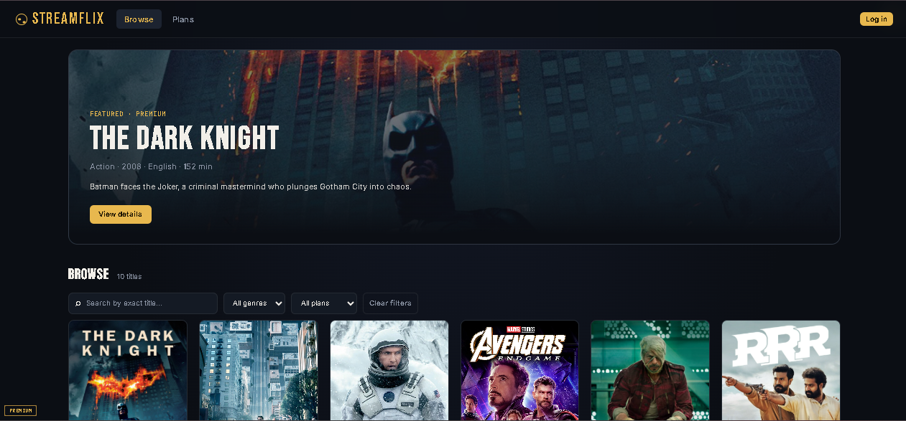
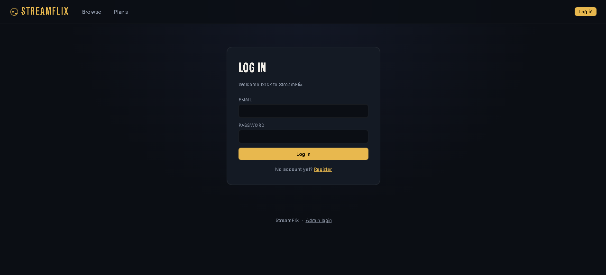
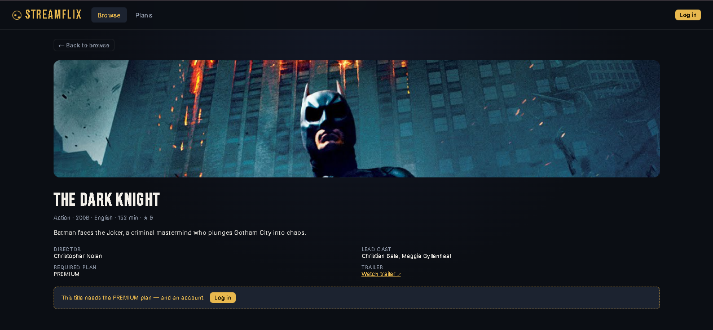
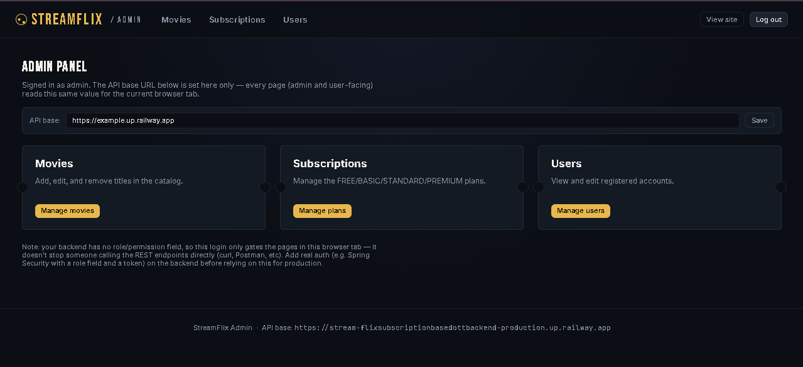
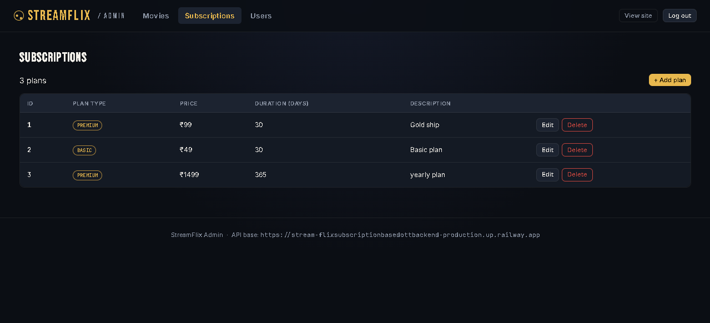

# StreamFlix — Subscription-Based OTT Platform

StreamFlix is a web application prototype for a subscription-based over-the-top (OTT) streaming platform. It combines a browser-based frontend with REST APIs for user management, movie browsing, and subscription-plan management.

> **Note:** The API documentation lists `http://localhost:8080` as the base URL. The frontend and API server must both be available for API-powered features to work. The repository's visible root contains the frontend files; backend startup instructions should be added if the backend source is maintained separately.

## Features

### Frontend
- Browse the movie catalogue.
- Search for a movie by title.
- Filter movies by genre and subscription plan.
- Registration and login pages.
- Movie details page.
- Subscription-plan page.
- Admin-related frontend files.

### API capabilities documented
- Register, log in, view, update, and delete users.
- Add, view, search, update, and delete movies.
- Add, view, search, update, and delete subscription plans.
- Filter movies by title, genre, and required subscription plan.

## Screenshots

The following screenshots show the StreamFlix user interface and admin pages.

### Browse / Home Page

<p align="center">
  
</p>

### Login Page

<p align="center">
  
</p>

### Movie Details Page

<p align="center">
  
</p>

### Admin Dashboard

<p align="center">
  
</p>

### Admin Subscription Management

<p align="center">
  
</p>

## Technology

| Component | Technology / interface |
|---|---|
| Frontend | HTML, CSS, JavaScript |
| Backend interface | REST API using HTTP and JSON |
| API base URL in the documentation | `http://localhost:8080` |
| Backend framework and database | Not specified in the supplied API documentation |

## Repository Structure

```text
Stream-Flix_Subscription_based_OTT_Backend-Frontend/
├── admin/
├── css/
├── js/
├── index.html
├── login.html
├── movie.html
├── plans.html
└── register.html
```

## Getting Started

### 1. Clone the repository

```bash
git clone https://github.com/Bramhendra-C/Stream-Flix_Subscription_based_OTT_Backend-Frontend.git
cd Stream-Flix_Subscription_based_OTT_Backend-Frontend
```

### 2. Run the frontend

The frontend uses HTML, CSS, and JavaScript. Open `index.html` in a browser, or open the folder in Visual Studio Code and use a local development server such as the Live Server extension.

### 3. Start the API server

The supplied API documentation uses this base URL:

```text
http://localhost:8080
```

Start the corresponding backend service separately and ensure that the endpoints below are reachable. The API PDF documents the routes and example payloads, but does not specify backend installation commands, the database setup, or configuration files. Add those instructions here once the backend source and configuration are available.

If the frontend cannot communicate with the API, check that the server is running, the base URL in the frontend's JavaScript matches the API server, and the server permits requests from the frontend origin (CORS).

## REST API Reference

Base URL: `http://localhost:8080`

### User endpoints

| Method | Endpoint | Purpose |
|---|---|---|
| `POST` | `/users/register` | Register a user |
| `POST` | `/users/login` | Log in a user |
| `GET` | `/users` | Get all users |
| `GET` | `/users/{id}` | Get a user by ID |
| `PUT` | `/users/{id}` | Update a user |
| `DELETE` | `/users/{id}` | Delete a user |

Example registration payload:

```json
{
  "name": "Example User",
  "email": "user@example.com",
  "password": "choose-a-password",
  "phoneNumber": "9876543210",
  "subscriptionType": "FREE",
  "subscriptionActive": true
}
```

The API documentation shows login as `POST /users/login?email={email}&password={password}`. See the security note below before using this design in a public deployment.

### Movie endpoints

| Method | Endpoint | Purpose |
|---|---|---|
| `POST` | `/movies` | Add a movie |
| `GET` | `/movies` | Get all movies |
| `GET` | `/movies/{id}` | Get a movie by ID |
| `GET` | `/movies/title/{title}` | Find movies by title |
| `GET` | `/movies/genre/{genre}` | Get movies by genre |
| `GET` | `/movies/plan/{plan}` | Get movies by required subscription plan |
| `PUT` | `/movies/{id}` | Update a movie |
| `DELETE` | `/movies/{id}` | Delete a movie |

Example movie payload:

```json
{
  "title": "Example Movie",
  "description": "An example movie description",
  "genre": "Action",
  "director": "Example Director",
  "hero": "Example Actor",
  "heroine": "Example Actress",
  "releaseYear": 2024,
  "rating": 8.0,
  "language": "English",
  "duration": 120,
  "thumbnailUrl": "thumbnail.jpg",
  "bannerUrl": "banner.jpg",
  "trailerUrl": "https://example.com/trailer",
  "videoUrl": "https://example.com/video.mp4",
  "requiredPlan": "PREMIUM"
}
```

### Subscription endpoints

| Method | Endpoint | Purpose |
|---|---|---|
| `POST` | `/subscriptions` | Add a subscription plan |
| `GET` | `/subscriptions` | Get all subscription plans |
| `GET` | `/subscriptions/{id}` | Get a subscription plan by ID |
| `GET` | `/subscriptions/plan/{plan}` | Find a plan by plan type |
| `PUT` | `/subscriptions/{id}` | Update a subscription plan |
| `DELETE` | `/subscriptions/{id}` | Delete a subscription plan |

Example subscription payload:

```json
{
  "planType": "PREMIUM",
  "price": 499,
  "durationDays": 30,
  "description": "Premium Plan"
}
```

### Documented HTTP status codes

| Code | Meaning |
|---|---|
| `200` | Success |
| `201` | Created |
| `400` | Bad Request |
| `401` | Unauthorized |
| `404` | Resource Not Found |
| `500` | Internal Server Error |

## Security Considerations

The supplied API document shows a password in the login URL query parameters and includes a password field in the registration response example. Query strings can be recorded in logs and browser history, and passwords should never be returned in API responses.

Before exposing this project publicly, update the API to accept credentials in a request body over HTTPS, store passwords using a suitable password-hashing algorithm, never return password values, validate input, and enforce authentication and authorization for protected and administrative operations. The documentation alone does not confirm whether these protections are implemented.

## Future Improvements

- Provide backend installation and database configuration instructions.
- Add environment-based configuration for the API URL instead of hard-coding it.
- Document authentication and authorization behaviour.
- Add automated tests for API endpoints and frontend flows.
- Add deployment instructions and screenshots of the running application.

## Project

Repository: [Stream-Flix Subscription-Based OTT Backend & Frontend](https://github.com/Bramhendra-C/Stream-Flix_Subscription_based_OTT_Backend-Frontend)

---

This README describes the repository structure and the API routes in the supplied StreamFlix Backend API Documentation. Confirm the implemented features and technologies against the source code before treating this document as a complete deployment guide.
